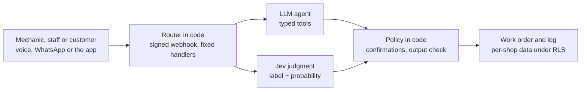
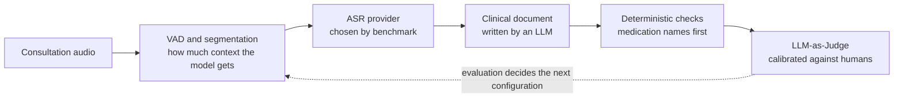

# Henrique Baptista · AI Portfolio

AI Engineer focused on LLM evaluation, agentic systems and voice AI.

- **Currently** — building HOB Oficina, the multi-tenant system auto mechanic shops run on, with agents, WhatsApp and voice. Sole engineer.
- **Previously** — ML / AI Engineer at VOA Health: clinical ASR benchmarks and LLM-as-Judge evaluators in production.
- **Open to** — AI Engineer roles, remote.

This repository is the public index of that work. Most of it runs in private repositories (client systems and my own products), so each entry says what it is and where to see it. The full case studies, with architecture and trade-offs, live at **[henriquebap.com/sobre](https://henriquebap.com/sobre)**.

- Postgraduate Program in Machine Learning Engineering, FIAP (completed 2026)
- Bachelor in Systems Analysis & Development, FIAP (completed Dec 2024)

---

## Featured work

### HOB Oficina · [product page (PT)](https://henriquebap.com/oficina)
*Own product · sole engineer · grew from the system Wil Mec runs on daily, multi-tenant platform live*

The system an auto mechanic shop runs on every day, now a multi-tenant product for other shops, with an AI layer built as a harness around the models.
- Agents with typed tools on the OpenAI Agents SDK; anything that writes data waits for a confirmation decided in code
- Jev, a TypeSafe System One model, makes the typed judgments (rank, classify, read a reply) with probabilities; code owns the policy and falls back to rules
- Guardrails in code: output check on customer-facing text, customer text wrapped as data, prices hidden from mechanics even in tool output
- One deploy, many shops: each shop isolated by Postgres RLS, with SQL tests guarding the isolation

`Next.js` `TypeScript` `OpenAI Agents SDK` `Jev (TypeSafe)` `Whisper` `Supabase / Postgres`

### Medical AI: from streaming ASR to LLM-as-Judge
*ML / AI Engineer at VOA Health, Feb 2025 to Jul 2026 · private system*

- Streaming ASR: characterized the context-versus-latency trade-off and tuned VAD and segmentation for the middle ground
- Benchmarked commercial ASR providers on clinical audio, with evaluation centered on medication names, not average WER
- Dual-annotator pipeline in Argilla feeding fine-tuning data to Hugging Face Hub
- LLM-as-Judge evaluators in production on LangSmith, calibrated against human annotation

`Python` `PyTorch` `Whisper` `Hugging Face` `Argilla` `LangSmith` `AWS S3` `Docker`

### WordinAI · [wordinai.com](https://wordinai.com)
*Own product · live SaaS, built and operated solo*

Turns sermons, lectures and meetings into documents people can search and trust.
- Deep agent on deepagents and LangGraph: planning, virtual filesystem, Postgres thread memory, and a source verifier among its subagents
- Citations assembled in code from tool outputs; tool output treated as untrusted
- Hybrid search (pgvector + full text) with a lexical fallback, and model routing by task
- Long-audio transcription on Groq Whisper with OpenAI failover

`Next.js` `TypeScript` `deepagents / LangGraph` `Whisper` `Supabase / pgvector` `Stripe`

### Education Risk Prediction · [repo](https://github.com/henriquebap/datathon-educacao-passos-magicos) · [live](https://henriquebap-datathon-educacao-passos-magicos.hf.space)
*FIAP capstone · social impact*

End-to-end ML system for identifying educational delay risk at an NGO: XGBoost, FastAPI, Streamlit dashboard, and Evidently AI drift monitoring. 92.59% accuracy and 0.97 ROC-AUC on held-out data.

### Insurance Computer Vision · [repo](https://github.com/henriquebap/R-CNN-OD-Sprint)
*Porto Seguro challenge · Top-10 finalist*

Detectron2 / Mask R-CNN pipeline for automating bicycle claim verification: custom COCO dataset, augmentation, transfer learning, cloud training.

---

## More projects

| Project | What it is | Link |
|---|---|---|
| Postgrad RAG Assistant | RAG over my ML postgrad material with page-level source citations and measured cost per query | private |
| Race Strategy Copilot | Endurance-racing strategist: Claude with extended thinking and the rulebook in prompt cache, on top of a deterministic pace engine | private |
| Local Voice Tutor | Language tutor fully offline on Apple Silicon: Whisper, Mistral 7B, Coqui TTS, no API calls | private |
| Experimental Stock Forecasting | PyTorch + FastAPI system whose monitoring exposed weak generalization | [repo](https://github.com/henriquebap/previsao_acoes) |
| Genetic Syndrome Classification | KNN over 320-dimensional image embeddings, t-SNE, multi-metric evaluation | [repo](https://github.com/henriquebap/Genetic_Syndrome_Classification_w_Embeddings_KNN) |
| Marine Vision Systems | YOLOv5/YOLOv9 detection of marine animals and marine waste | [YOLOv9](https://github.com/henriquebap/Blue-Clean-YoloV9) · [YOLOv5](https://github.com/henriquebap/YoloV5-Shark-Detection) |
